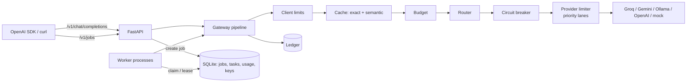

# Switchboard

A self-hosted **LLM gateway + batch job scheduler**. One OpenAI-compatible API in front of Groq, Gemini, Ollama, OpenAI (optional) and a built-in mock provider. Two entry points share the same cache, router, rate limiter and cost ledger:

* **Online** - `POST /v1/chat/completions` (streaming supported)
* **Offline** - `POST /v1/jobs` for thousands of asynchronous tasks processed by separate worker processes

Both paths compete for the same provider rate limits and budget, so the gateway prioritises interactive traffic, shares the cache, and fails over when a provider breaks. Everything runs for free: no paid service is required for any feature.

## Honest status (read this first)

This was built in a sandbox with **no network and no FastAPI/pytest installed**, so verification is uneven:

| Area | Status |
|---|---|
| Rate limiter (priority lanes, window guarantee, starvation guard), circuit breaker, retry/backoff, cache, router, ledger/budgets, gateway pipeline (failover, streaming, single-flight), durable queue, workers, DLQ, idempotency | **Implemented and tested** (78 `unittest`-based tests, all passing; also pytest-compatible) |
| SIGKILL crash recovery (real worker processes), 5,000-task job with injected 429s/5xx (no lost / duplicated tasks) | **Tested / benchmarked** |
| `ruff`, `mypy` | **Not run** (not installed offline). CI is configured to run them; expect some lint/type nits on first run |
| Benchmarks | **Run, with the mock provider only** (see `docs/BENCHMARKS.md`) |
| FastAPI HTTP layer, SSE framing, OpenAI-SDK compatibility | **Written but NOT executed** here. `tests/integration/test_api.py` is included and skips itself when FastAPI is missing |
| Redis/Lua limiter | **Written but NOT run against a live Redis** (mirrors the tested Python version) |
| Real providers (Groq/Gemini/Ollama/OpenAI) | Pure parsing helpers tested; **no live calls were made** |
| Semantic cache with a real embedding model (`bge-small`) | **Not measured** (model not available offline). The fallback hashing embedder was measured and is *not* good enough, so the semantic layer is off unless a real model is loaded |
| Postgres/pgvector, Redis-backed queue/cache, Next.js dashboard, OpenTelemetry | **Not implemented** (SQLite + in-process cache + a static dashboard page instead; see `docs/DECISIONS.md`) |

## Architecture



Details: [`docs/ARCHITECTURE.md`](docs/ARCHITECTURE.md) · API: [`docs/API.md`](docs/API.md) · Decisions: [`docs/DECISIONS.md`](docs/DECISIONS.md) · Numbers: [`docs/BENCHMARKS.md`](docs/BENCHMARKS.md)

## Quickstart

### Lite mode (no Docker, no keys)
```bash
python -m venv .venv && source .venv/bin/activate
pip install -e ".[dev]"            # add ,embeddings for the real semantic cache; ,redis for Redis limiter
switchboard serve --with-worker    # http://localhost:8000  (mock provider when no keys are set)
python examples/openai_demo.py
```

### Docker
```bash
cp .env.example .env               # optionally add GROQ_API_KEY / GEMINI_API_KEY (free tiers)
docker compose up --build          # gateway :8000 + worker + Redis (Redis backs the rate limiter)
```
Dashboard: <http://localhost:8000/dashboard> (set `ADMIN_KEY` and paste it in the page).

### Real free providers
Set `GROQ_API_KEY` and/or `GEMINI_API_KEY` (and `ENABLE_OLLAMA=true` for a local Ollama). **Edit the `rpm`/`tpm` of each provider in `src/switchboard/models.yaml` to match your account's current free-tier limits**; the shipped values are conservative placeholders.

## 60-second demo with the OpenAI SDK
```python
from openai import OpenAI
client = OpenAI(base_url="http://localhost:8000/v1", api_key="anything")   # only base_url changes
r = client.chat.completions.with_raw_response.create(
    model="gpt-4o", temperature=0, messages=[{"role": "user", "content": "What is the capital of France?"}])
print(r.headers["x-provider"], r.headers["x-model"], r.headers["x-cache"], r.headers["x-cost-saved-usd"])
```
`gpt-4o`, `llama-3.3-70b-versatile`, `gemini-2.5-flash` and `auto` all work through the same endpoint. If a vendor's key is missing, the request is served by an enabled model of the same tier and the `X-Provider`/`X-Model` headers say so (`ALLOW_SUBSTITUTION=false` to disable).

Batch:
```bash
curl -s localhost:8000/v1/jobs -H 'content-type: application/json' -d '{"model":"auto","priority":"bulk",
  "idempotency_key":"demo-1","requests":[{"messages":[{"role":"user","content":"hi"}],"temperature":0}]}'
```

## Features
* OpenAI-compatible chat + SSE streaming + `/v1/models`; `X-Cache`, `X-Cost-*`, `X-Provider`, `X-Model` headers
* **Rate limiter**: atomic dual token buckets (requests/min + tokens/min), 4 priority lanes (reserved capacity + guaranteed shares), provable "never more than N per any 60 s window", in-memory and Redis/Lua implementations behind one interface
* Circuit breaker (closed/open/half-open, exponential cool-down), per-tier fallback chains, constraint-aware failover (context length, tools)
* Cache: exact + semantic, namespaced, TTL, invalidation API, single-flight coalescing, lexical safety guard
* Router: heuristic v1 + learned (TF-IDF + logistic regression) v2, online = lowest latency, batch = lowest price, every decision logged
* Batch: JSON/NDJSON jobs, leases, full-jitter backoff, DLQ with requeue, idempotency keys, cancel, `max_concurrency`, webhook, graceful shutdown, crash recovery
* Ledger + budgets: per-request rows, per key/model/day rollups, soft/hard budgets (reject or downgrade tier), `% saved vs naive baseline`
* Prometheus `/metrics`, JSON logs with request ids, PII redaction, prompts never logged by default, hashed API keys, size limits

## Headline benchmark (mock provider, 5,000 synthetic prompts; full details and caveats in [docs/BENCHMARKS.md](docs/BENCHMARKS.md))

| Config | Equiv. cost saved vs naive | Tasks/min | Client-visible 429s | Quality (simulated) |
|---|---:|---:|---:|---:|
| Naive: all to strongest model, sequential | 0.0% | 3,362 | 99 | 100.0% |
| Naive: 64 parallel clients, retry on 429 | 0.0% | 4,958 | 64 | 100.0% |
| Gateway, no cache, no routing | 0.0% | 2,783 | 0 | 100.0% |
| Gateway + cache (exact) | 28.2% | 3,921 | 0 | 100.0% |
| Gateway + heuristic routing | 41.5% | 2,783 | 0 | 95.0% |
| Gateway + cache + heuristic routing | 57.7% | 3,921 | 0 | 95.0% |
| Gateway + cache + learned routing | 41.7% | 3,921 | 0 | 98.4% |

Interactive latency while a bulk load saturates a 600 req/min provider: p95 **25 ms** with priority lanes (vs 25 ms with no bulk load) and **1,958 ms** with lanes disabled. The provider never saw more than **558** requests in any 60 s window (limit 600). The semantic cache layer is off with the bundled fallback embedder because it measurably returned wrong answers (see BENCHMARKS.md section 3); savings above come from exact-duplicate hits and routing. Quality is the mock provider's simulated tier model, not an LLM judge.


## Limitations
* Single-node cache and SQLite store (see Decisions 5, 9); API replicas do not share the cache.
* Mock-provider benchmarks only; real-provider latency/quality not measured. `quality` in the benchmark is the mock's simulated tier model, not an LLM judge.
* The gateway deliberately admits ~10 % fewer requests than the provider limit (window guarantee), and interactive burst is capped at 75 % of bucket capacity (guaranteed shares are held back).
* Token usage on some streams is estimated (`tokens_estimated` in the ledger).
* Webhooks are best-effort and do no SSRF filtering beyond requiring http(s).

## Roadmap
Verify the HTTP layer and Redis limiter in CI with real services; Postgres/pgvector + Redis Streams backends; measure `bge-small` and pick the cache threshold; LLM-as-judge quality report; Next.js dashboard; OpenTelemetry; per-model limit overrides in YAML UI.

## Development
```bash
pytest -q                                  # or: PYTHONPATH=src python -m unittest discover -s tests -t .
ruff check src tests benchmarks && mypy src
```
Tests use an injectable clock so limiter/breaker/lease tests never sleep. `tests/integration/test_crash_recovery.py` SIGKILLs a real worker process mid-job.
