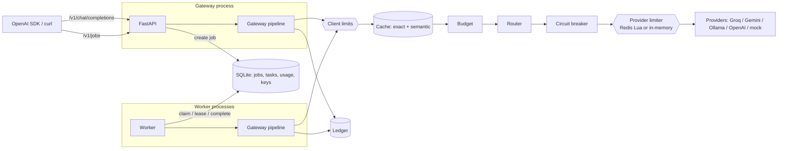

# Architecture

## One pipeline, two entry points
`Gateway.handle()` is used by the online endpoint and by every batch task. In order:

1. **Client limit** (per API key rpm/tpm) - online: `429 + Retry-After`; batch: deferred.
2. **Cache** - exact hash, then semantic (single-turn, guarded). Concurrent identical requests are coalesced (single-flight). Hits are recorded with *cost saved*.
3. **Budget** - soft threshold adds `X-Budget-Warning`; hard threshold rejects or caps the tier at `cheap` (key policy). Cache hits are still served.
4. **Router** - explicit model -> honoured + tier fallback chain; `model:"auto"` -> classifier (heuristic or learned) picks the cheapest adequate tier; online policy = lowest latency, batch policy = lowest price. Every decision is logged (`/admin/routing`).
5. **Attempt chain** - per candidate: skip if breaker open -> admit through the provider limiter (bounded wait on online, up to `BATCH_MAX_WAIT_S` on batch) -> breaker probe slot -> provider call with timeout. 5xx/timeout -> next candidate; 429 -> next candidate; 400 -> returned to the client. If nothing could be tried only because of capacity, online gets `429`/`503` with `Retry-After`, batch gets `Deferred` (re-queued, no attempt consumed).
6. **Ledger** - one row per request: tokens (real or `estimated`), latency, TTFT, cache status, billed cost, equivalent cost, baseline cost, saved cost, outcome, retry count.

## Rate limiter (`limits/token_bucket.py`)
Dual bucket (requests/min, tokens/min) per provider. See DECISIONS 2-4. The same pure functions (`refill`, `decide`, `commit`) back the in-memory limiter; `LUA_ACQUIRE` re-implements them atomically for Redis.

## Batch scheduler (`scheduler/`)
`queue.py` (durable SQLite queue with leases and fencing), `worker.py` (async worker, heartbeat, graceful shutdown), `retry.py` (full-jitter exponential backoff, retryable vs permanent), `dlq.py`, `jobs_service.py` (job status incl. cost so far and ETA, JSONL results, idempotency keys, webhook).

## Layout differences from the spec
* `api/schemas.py` is absent (hand-written validation, see DECISIONS 1); `db/` uses plain SQL instead of Alembic (DECISIONS 5).
* `limits/priority.py` and `limits/lua/` are folded into `token_bucket.py` (the Lua script is a string constant next to the Python version it mirrors).
* `routing/policies.py` is folded into `router.py`; `routing/dataset.py` holds the router training-data generator.
* `dashboard/` is a single static `dashboard.html` inside the package.
