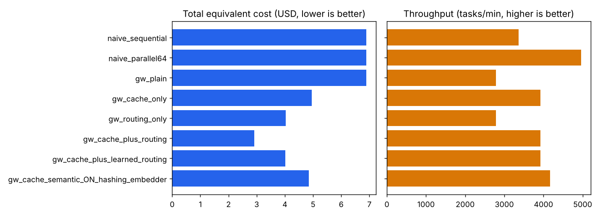
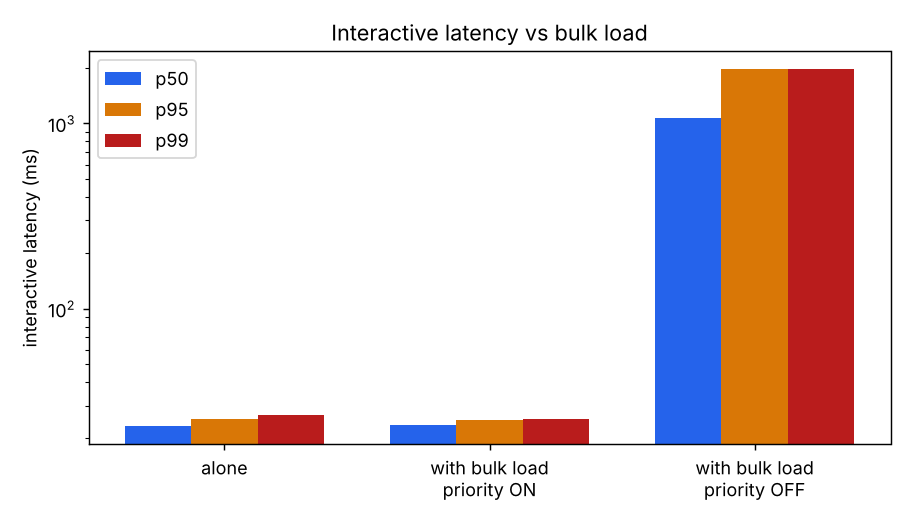
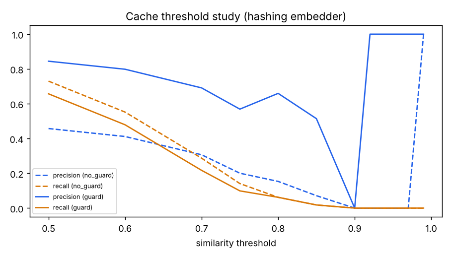

# Benchmarks

Every number below was produced by the scripts in `benchmarks/` and copied here by `benchmarks/report.py`. Raw outputs are in `benchmarks/results/*.json`. **All runs use the built-in mock provider** (no API keys, no network) in a CPU-only sandbox, so absolute latencies are mock-scaled (4/8/12 ms for cheap/balanced/strong); relative comparisons and the correctness properties are what matter. Costs are *equivalent* costs at the reference prices in `models.yaml` (cheap $0.15/$0.60, balanced $0.50/$2.00, strong $2.50/$10.00 per 1M in/out tokens), not real invoices.

## 1. Cost, throughput and quality (5,000-prompt workload)

Workload (`benchmarks/workload_gen.py`, seed 7): 5,000 synthetic prompts = 2,500 first occurrences + 1,250 exact duplicates + 1,250 paraphrases (same slots, different wording); ~60% easy / ~40% hard. Provider limit: 3,000 requests/min (sliding window), below the workload size, like a real free tier. *Naive baseline* = every prompt straight to the strongest model, no cache, no gateway. Gateway runs submit the workload as one batch job (64 concurrent workers). `quality` = fraction of answers equal to the reference answer under the mock's simulated tier-quality model (see `providers/mock.py`): **this is a simulation, not an LLM-judge measurement.**

| Config | Equiv. cost (USD) | Saved vs naive | Tasks/min | Upstream calls | Cache hit rate | Client-visible 429s | Quality |
|---|---:|---:|---:|---:|---:|---:|---:|
| naive_sequential | 6.8917 | 0.0% | 3,362 | 5099 | 0.0% | 99 | 100.0% |
| naive_parallel64 | 6.8917 | 0.0% | 4,958 | 5064 | 0.0% | 64 | 100.0% |
| gw_plain | 6.8917 | 0.0% | 2,783 | 5000 | 0.0% | 0 | 100.0% |
| gw_cache_only | 4.9501 | 28.2% | 3,921 | 3592 | 28.2% | 0 | 100.0% |
| gw_routing_only | 4.0322 | 41.5% | 2,783 | 5000 | 0.0% | 0 | 95.0% |
| gw_cache_plus_routing | 2.9147 | 57.7% | 3,921 | 3592 | 28.2% | 0 | 95.0% |
| gw_cache_plus_learned_routing | 4.0193 | 41.7% | 3,921 | 3592 | 28.2% | 0 | 98.4% |
| gw_cache_semantic_ON_hashing_embedder | 4.8497 | 29.6% | 4,165 | 3390 | 32.2% | 0 | 94.6% |

Notes:
- `client_429s` for the naive rows = 429 responses the client received (and had to wait out); for gateway rows the client never sees them (the limiter admits requests below the provider limit). Provider-side 429s seen *by the gateway* are in the JSON (`provider_429s_seen_by_gateway`).
- Cache hits in the default rows are **exact duplicates (and single-flight coalescing)**; the semantic layer is off with the fallback hashing embedder (section 3), so paraphrases are not deduplicated. The `gw_cache_semantic_ON_hashing_embedder` row forces it on to show the damage: its quality column drops below 100% even though every request is sent to the strongest model, i.e. the loss is entirely wrong cache hits.
- **Throughput caveat:** `gw_plain` is *slower* than the naive clients. The gateway deliberately stays ~10% below the provider limit (window guarantee, DECISIONS 3) to guarantee zero 429s, while the naive clients simply burst and wait out 429s. The gateway's throughput advantage comes only from not making upstream calls (cache hits), not from the limiter.
- The heuristic router sends some hard prompts to cheaper tiers, which is where its quality loss comes from; the learned router is better on this workload but was trained on a generator with similar structure, so its near-perfect routing here should not be expected on real traffic.

### Router accuracy on this workload (unique prompts, labels hidden from the router)

| Classifier | easy -> cheap | hard -> not cheap | hard -> strong |
|---|---:|---:|---:|
| heuristic | 100.0% | 91.6% | 66.3% |
| learned | 100.0% | 100.0% | 100.0% |

The learned classifier was trained on a *different* synthetic generator (`routing/dataset.py`, 4000 prompts; in-distribution validation accuracy 100.0%), so the table above is a transfer test. Real traffic is messier; treat all of these as optimistic.



## 2. Rate-limit compliance, priority lanes and failover

Provider limit 600 requests/min, mock latency 20 ms, interactive load 4 req/s (open loop), bulk load = 48 closed-loop workers in the `bulk` lane.

| Scenario | interactive ok | interactive 429 | p50 ms | p95 ms | p99 ms | bulk req/s |
|---|---:|---:|---:|---:|---:|---:|
| interactive alone | 80 | 0 | 23.2 | 25.4 | 26.8 | 0.00 |
| + bulk load, priority lanes ON | 280 | 0 | 23.5 | 25.1 | 25.5 | 5.27 |
| + bulk load, priority lanes OFF | 29 | 51 | 1,075.3 | 1,958.2 | 1,961.4 | 11.30 |

**Limit compliance:** during the 70 s priority-ON run (interactive + saturating bulk), the maximum number of requests the provider accepted in *any* sliding 60 s window was **558** (limit 600); provider-side 429s: **0**.



### Failover under an injected outage

Two mock providers, 50 req/s of `mock-strong` traffic, primary hard-down for 12 s, breaker base cool-down 5.0 s.

| Metric | Value |
|---|---:|
| requests | 1432 |
| success rate (overall) | 100.00% |
| success rate during outage | 100.00% |
| share served by fallback during outage | 100.0% |
| requests *successfully served by the primary* during its outage (must be 0) | 0 |
| p95 latency before outage (ms) | 25.1 |
| p95 latency during outage (ms) | 25.1 |
| seconds after recovery until the primary serves again | 3.1 |

## 3. Semantic-cache threshold study

Embedder: **hashing**. 1000 paraphrase pairs (should hit) and 1000 near-miss pairs (same wording, different number/entity; must NOT hit), synthetic, from `workload_gen.pairs()`. Mean similarity: paraphrases 0.569, near-misses 0.723.

| Threshold | Precision | Recall | FP rate | Precision (+guard) | Recall (+guard) | FP rate (+guard) |
|---:|---:|---:|---:|---:|---:|---:|
| 0.50 | 0.457 | 0.730 | 0.866 | 0.844 | 0.657 | 0.121 |
| 0.60 | 0.412 | 0.552 | 0.789 | 0.798 | 0.479 | 0.121 |
| 0.70 | 0.307 | 0.287 | 0.649 | 0.691 | 0.217 | 0.097 |
| 0.75 | 0.201 | 0.141 | 0.562 | 0.569 | 0.099 | 0.075 |
| 0.80 | 0.153 | 0.062 | 0.342 | 0.660 | 0.062 | 0.032 |
| 0.85 | 0.071 | 0.018 | 0.234 | 0.514 | 0.018 | 0.017 |
| 0.90 | 0.000 | 0.000 | 0.111 | 0.000 | 0.000 | 0.001 |
| 0.92 | 0.000 | 0.000 | 0.105 | 1.000 | 0.000 | 0.000 |
| 0.95 | 0.000 | 0.000 | 0.093 | 1.000 | 0.000 | 0.000 |
| 0.97 | 0.000 | 0.000 | 0.009 | 1.000 | 0.000 | 0.000 |
| 0.99 | 1.000 | 0.000 | 0.000 | 1.000 | 0.000 | 0.000 |

### In-situ replay (nearest-neighbour search over everything cached so far)

The pairwise table above only compares matched pairs. Here the 5000-prompt workload is replayed through the real `SemanticCache`; a hit is *wrong* when the cached answer belongs to a different question. First row: semantic layer off (the default with this embedder).

| Semantic layer | Guard | Threshold | Exact hits (correct) | Semantic hits correct | Semantic hits WRONG | Wrong-answer rate | Paraphrase recall |
|---|---|---:|---:|---:|---:|---:|---:|
| off | yes | 0.92 | 1408 | 0 | 0 | 0.00% | 0.0% |
| on | no | 0.80 | 504 | 3 | 3178 | 63.56% | 0.2% |
| on | no | 0.85 | 645 | 1 | 2706 | 54.12% | 0.1% |
| on | no | 0.90 | 794 | 0 | 2199 | 43.98% | 0.0% |
| on | no | 0.92 | 925 | 0 | 1756 | 35.12% | 0.0% |
| on | no | 0.95 | 1101 | 0 | 1081 | 21.62% | 0.0% |
| on | no | 0.97 | 1368 | 0 | 163 | 3.26% | 0.0% |
| on | no | 0.99 | 1405 | 0 | 9 | 0.18% | 0.0% |
| on | yes | 0.80 | 1238 | 3 | 628 | 12.56% | 0.2% |
| on | yes | 0.85 | 1257 | 1 | 582 | 11.64% | 0.1% |
| on | yes | 0.90 | 1313 | 0 | 389 | 7.78% | 0.0% |
| on | yes | 0.92 | 1341 | 0 | 274 | 5.48% | 0.0% |
| on | yes | 0.95 | 1393 | 0 | 64 | 1.28% | 0.0% |
| on | yes | 0.97 | 1403 | 0 | 19 | 0.38% | 0.0% |
| on | yes | 0.99 | 1405 | 0 | 9 | 0.18% | 0.0% |

**Reading this honestly:** the fallback hashing embedder is lexical. It scores near-misses *higher* than paraphrases, so no threshold gives both useful recall and high precision. In the in-situ replay the semantic layer returns ~0 correct paraphrase hits and a non-trivial rate of wrong answers, so it is **disabled by default with this embedder** (`CACHE_SEMANTIC=auto`). Install `pip install -e .[embeddings]` and run `python benchmarks/eval_cache_threshold.py --embedder auto` to produce the table for `BAAI/bge-small-en-v1.5` and pick a threshold from it; **that measurement was not possible in the build sandbox** (no network, model not installed), so no numbers are claimed for it.



## 4. 5,000-task batch job under injected failures

Two workers (32 concurrent tasks each) share one durable queue. The mock provider hard-limits 300 calls/s (the gateway limiter is set looser on purpose, so the provider returns real 429s) and fails ~10% of other calls with 5xx/timeouts.

| Metric | Value |
|---|---:|
| tasks | 5000 |
| wall time (s) | 10.6 |
| tasks done / dead / pending | 5000 / 0 / 0 |
| distinct tasks charged in the ledger | 5000 |
| tasks charged more than once | 0 |
| results returned / succeeded | 5000 / 5000 |
| provider 429s received | 14403 |
| injected 5xx/timeouts | 528 |
| total provider calls | 19931 |
| tasks that needed more than one attempt | 3613 |
| **no lost, no duplicated** | **True** |

Process-level crash recovery (SIGKILL of a real worker mid-job, lease expiry, exactly-once charging) is covered by `tests/integration/test_crash_recovery.py`.

## Reproduce

```bash
pip install -e '.[bench]'
export PYTHONPATH=src:benchmarks
python benchmarks/train_router.py             # trains the learned router -> router_train.json
python benchmarks/eval_cache_threshold.py     # section 3 (pairwise)
python benchmarks/eval_cache_index.py         # section 3 (in-situ replay)
python benchmarks/run_bench.py                # section 1 (~10 min)
python benchmarks/run_latency.py              # section 2 (~2.5 min; --quick for a short run)
python benchmarks/run_job_chaos.py           # section 4
python benchmarks/report.py                   # regenerates this file + charts
```

## What was NOT measured

* Any real provider (Groq/Gemini/Ollama/OpenAI): no keys or network in the build sandbox.
* Semantic-cache behaviour with a real embedding model (see section 3).
* Quality with an LLM-as-judge; `quality` above is the mock's simulation.
* The Redis/Lua limiter against a live Redis; the HTTP layer under load; the dashboard in a browser.
